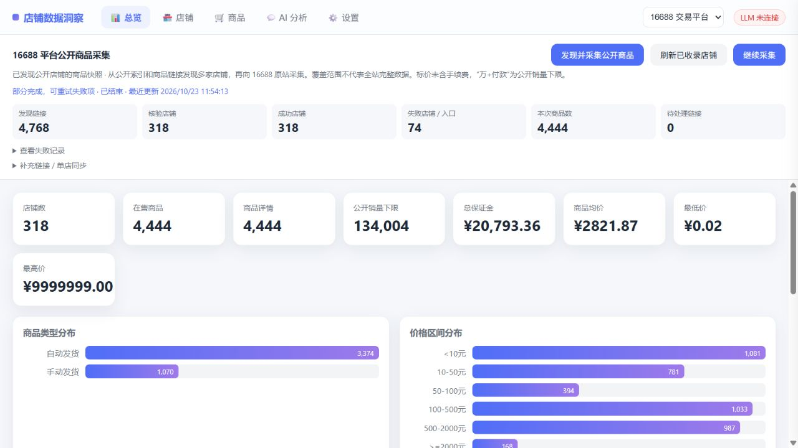

# wzyp-view — 链动小铺 / 16688 商品数据洞察

支持 [链动小铺](https://wzyp.cn) 数据快照与 [16688](https://www.16688.com.cn) 公开商品采集的可视化及 LangGraph AI 分析工具。原链动小铺快照含 **250 家店铺 / 11,042 件在售商品**；16688 数据由平台采集任务生成。

> 🎨 **[在线宣传页](https://samge0.github.io/wzyp-view/)** — 功能总览 · AI 架构 · 快速开始

- 📊 可视化总览：统计卡 / 商品类型分布 / 价格区间 / 热词云 / 销量 Top10，**全部支持点击下钻**到对应筛选结果
- 🏪 店铺 / 🛒 商品多维查询：字段筛选构建器（≥/≤/like…）、表头+下拉双排序、抓取状态筛选、排除 0 元、商品详情抽屉
- 💬 AI 分析：LangGraph Agent 流式对话（markdown 渲染、自动追问建议、多会话管理），支持「AI 解读」把当前查询结果一键带入聊天
- ⚙️ 页面化配置：LLM 与 MySQL 连接全部在网页设置页配置（保存前自动测连、热生效），支持配置导入/导出
- 🔗 **16688 平台采集**：自动发现公开店铺与商品链接，按原站店铺编号去重后批量采集；支持进度查看、取消、重启恢复与断点续跑，采集结果统一参与总览、筛选、详情和 AI 分析。

## 采集 16688 平台公开商品

16688 数据源无需安装 MySQL 或导入原链动小铺快照。按下方步骤安装 Python 依赖、运行 `python run.py`，打开 **http://127.0.0.1:8770** 即可。

1. 顶栏选择 **16688 交易平台**（新浏览器默认选中）。
2. 点击 **发现并采集公开商品**。程序读取公开索引的全部商品分页，从中提取 16688 店铺／商品链接，再向 16688 原站采集各店的公开商品；商品描述中的 16688 链接也会加入发现队列。
3. 面板每两秒更新发现链接、核验店铺、成功／失败数量、商品数和待处理数量。**取消采集**会停止后续请求并保留已完成快照；**继续采集**跳过已完成店铺，重试失败或未完成的部分。
4. 以后点击 **刷新已收录店铺**，可更新已经收录的店铺，无需重新读取公开索引。
5. 在总览查看统计、在店铺与商品页搜索筛选、点击商品名称查看详情。配置 LLM 后可使用 AI 分析。

展开 **补充链接 / 单店同步** 可每行添加一个 16688 链接，加入下一次批量任务，也可仅同步明确指定的一个店铺。默认不绑定任何特定商品或店铺。

也可以从命令行采集（16688 与链动小铺 CLI 参数一致）：

```bash
# 16688 交易平台：自动发现并批量采集公开商品
python platform16688.py crawl
python platform16688.py refresh
python platform16688.py crawl --resume JOB_ID
python platform16688.py crawl --url https://www.16688.com.cn/shop/XIAOQING
python platform16688.py https://www.16688.com.cn/goods/G74884541

# 链动小铺（最新采集，保存至 data/wzyp.sqlite3，source=wzyp-live）：
python platformwzyp.py crawl
python platformwzyp.py refresh
python platformwzyp.py crawl --resume JOB_ID
python platformwzyp.py crawl --url https://wzyp.cn/shop/9B5624X
python platformwzyp.py https://wzyp.cn/shop/9B5624X
```

CLI 每次进度变化会输出任务编号及统计；`Ctrl+C` 取消当前 CLI 创建的任务。网页和 CLI 共用同一数据库时，只允许一个平台任务运行，重复启动会返回已有任务。服务重启后，未完成任务会标记为中断，点击继续或使用 `--resume` 恢复；不会自动定时执行。

默认两个采集工作线程，进程内共享每秒两次请求的限速。超时、连接失败、HTTP 429 和临时服务器错误每个请求最多尝试三次，并遵循 `Retry-After`（最长等待 60 秒）。失效店铺、商品和读取失败会记录具体入口，不会阻断其他店铺。

数据及任务检查点默认保存在 `data/16688.sqlite3`，可通过 `WZYP_16688_DB` 指定文件。旧版 SQLite 会自动增加任务表，已有快照保持不变。每个店铺完整读取成功后才更新该店快照，并移除已不在公开列表中的商品；其他店铺保持不变。网络失败、平台返回异常或不完整列表时保留之前的数据。Docker 的 `./data` 挂载同时保存快照与采集任务。

**发现来源与覆盖范围**：首个发现源为 [PriceMap AI 公开索引](https://pricemapai.com/data/latest.json)，使用版本化清单校验全部商品分页；版本变化或分页失效时重新读取一次，仍不完整则保留旧数据并报告。第三方索引仅用于发现链接，价格、库存、描述和分类均从 16688 原站采集。只跟随已公开的 16688 商品／店铺链接，不枚举编号、不使用商家登录态。公开索引有收录范围，结果应称为“已发现公开店铺的商品快照”，不代表全站或全部类目完整数据。

**数据口径**：价格为公开标价，未含平台手续费；未公开的市场价、实付价和开店日期保留为空。“1.3万+付款”以原文保存，排名与汇总使用 13,000 作为公开下限，不代表精确销量。`auto` / `manual` / `unknown` 分别表示自动发货、手动发货和未公开发货方式；手动发货返回的库存 `-1` 按未公开数量处理。平台商品分类单独保存。HTML 描述在受限 iframe 中显示。

切换到 **链动小铺** 仍使用原 MySQL 配置。两个数据源的数据库、AI 查询上下文及聊天历史分别保存；原有 API 不传 `source` 时仍默认使用链动小铺。



新增接口：

| 接口 | 说明 |
|------|------|
| `GET /api/sources` | 可用数据源 |
| `POST /api/sources/16688/crawl` | `{"mode":"discover","urls":[]}`；mode 为 discover（默认）或 refresh |
| `GET /api/sources/16688/crawl` | 最近的任务，优先返回运行中的任务：`{"job":任务或null}` |
| `GET /api/sources/16688/crawl/{job_id}` | 指定任务的状态、进度与最近失败记录 |
| `POST /api/sources/16688/crawl/{job_id}/cancel` | 取消任务，返回任务编号及状态 |
| `POST /api/sources/16688/crawl/{job_id}/resume` | 续跑失败、部分完成、中断或取消的任务 |
| `POST /api/sources/16688/sync` | 请求体 `{"url":"https://www.16688.com.cn/shop/XIAOQING"}` |
| `POST /api/sources/wzyp/crawl`、`GET /api/sources/wzyp/crawl*`、`POST /api/sources/wzyp/sync` | 链动小铺（最新采集 `source=wzyp-live`）批量采集、状态、取消、续跑与单店同步 |
| `/api/stats?source=16688` | 本地快照统计 |
| `/api/shops?source=16688`、`/api/goods?source=16688` | 复用原查询请求体 |
| `/api/goods/{goods_key}?source=16688` | 商品详情 |
| `/api/chat?source=16688` | 当前数据源的 AI 分析 |
| `GET /api/health` | 服务健康检查，不依赖 MySQL 或 LLM |

任务响应包含 `job_id`、`mode`、`status`、`phase`、`discovered_links`、`resolved_shops`、`success_shops`、`failure_count`、`collected_goods`、`pending_links`、`updated_at` 和失败记录。状态包括 `running`、`cancelling`、`cancelled`、`interrupted`、`completed`、`partial`、`failed`。任务表与队列表不在 AI 查询权限内。

离线回归测试（使用仓库依赖中的 HTTPX，无需实际商店网络、MySQL 或 LLM 服务）：

```bash
python -m unittest discover -s tests -v
```

## 界面预览

**📊 数据总览** — 一屏掌握全站规模，所有卡片与图表可点击下钻：


**💬 AI 分析** — 自然语言查询，流式 markdown 回复 + 自动追问建议（回答引用真实库内链接）：


**🛒 商品查询 + 详情抽屉** — 多维筛选，点击商品名查看 HTML 描述全文：


**🏪 店铺列表** — 关键词搜索 + 字段筛选构建器 + 双排序，含抓取状态徽章：


**⚙️ 设置页** — LLM 与 MySQL 页面化配置、连通测试、配置导入/导出：


## 快速开始

### 方式一：本地运行（uv）

#### 1. 准备数据（仅链动小铺需要，使用 16688 可跳过）

从 [Releases](../../releases) 下载 `wzyp-data.zip`（约 16 MB，含三张表全量数据），解压后导入 MySQL：

```bash
# 创建数据库
mysql -u root -p -e "CREATE DATABASE IF NOT EXISTS wzyp DEFAULT CHARSET utf8mb4 COLLATE utf8mb4_unicode_ci"

# 按顺序导入（ shops 先导，goods 有外键依赖 ）
mysql -u root -p wzyp < wzyp_shops.sql
mysql -u root -p wzyp < wzyp_goods.sql
mysql -u root -p wzyp < wzyp_goods_detail.sql
```

> 也可以在 `mysql` 交互终端里用 `SOURCE wzyp_shops.sql;` 的方式逐个执行。
> 压缩包内附 `README-IMPORT.txt` 说明。

#### 2. 创建虚拟环境（[uv](https://docs.astral.sh/uv/)）

```bash
cd wzyp-view

# 创建虚拟环境（默认 .venv，Python ≥ 3.11）
uv venv --python 3.13

# 安装依赖（国内可加 --index-url https://pypi.tuna.tsinghua.edu.cn/simple）
uv pip install -r requirements.txt
```

#### 3. 启动

```bash
# 激活虚拟环境
#   Windows (cmd):
.venv\Scripts\activate
#   Windows (PowerShell):
.venv\Scripts\Activate.ps1
#   Linux / macOS:
source .venv/bin/activate

# 启动服务
python run.py
```

> 不激活环境也可以直接跑：`.venv\Scripts\python.exe run.py`（Windows）或 `.venv/bin/python run.py`（Linux/macOS）

#### 4. 配置并使用

浏览器打开 **http://127.0.0.1:8770** → 进入 **⚙️ 设置** 页：

1. **🗄️ 数据库配置**：填 MySQL 地址 / 端口 / 账号密码 / 库名（`wzyp`），点「测试连接」确认后保存
2. **🤖 LLM 配置**：填任意 OpenAI 兼容接口（DeepSeek / 智谱 / 本地 vLLM / Ollama…）的 Base URL、Model、API Key，测试保存

配置持久化在 `data/settings.json`，重启不丢。也可复制 `data/settings.example.json` 手动编辑，或使用环境变量（见下）。

### 方式二：Docker

```bash
git clone https://github.com/Samge0/wzyp-view.git
cd wzyp-view
docker compose up -d --build
# 访问 http://localhost:8770
```

- 配置同样走页面设置（持久化在 `./data` volume）
- 容器内访问宿主机 LLM 服务用 `http://host.docker.internal:16869/v1`
- 也可用环境变量注入配置（优先级高于页面）：

```yaml
environment:
  WZYP_DB_HOST: 127.0.0.1
  WZYP_DB_PORT: "3306"
  WZYP_DB_USER: root
  WZYP_DB_PASSWORD: "your-password"
  WZYP_DB_DATABASE: wzyp
  WZYP_LLM_BASEURL: http://host.docker.internal:16869/v1
  WZYP_LLM_MODEL: qwen38
  WZYP_LLM_APIKEY: ""
```

## 数据说明

| 表 | 行数 | 说明 |
|----|------|------|
| `wzyp_shops` | 250 | 店铺（token 主键、销量、保证金、联系方式、`fetch_done` 抓取状态） |
| `wzyp_goods` | 11,042 | 在售商品（goods_key、店铺外键、类型 card/article/resource/equity、价格） |
| `wzyp_goods_detail` | 10,769 | 商品详情（HTML 描述全文、图片、真实价） |

数据采集自公开接口（2026-09 快照），少量差额为采集期间已下架商品。数据仅供学习研究，请勿用于商业用途。

## AI 架构（LangGraph）

```
planner(LLM+bind_tools) ⇄ tools(只读SQL+schema) → END
```

**防幻觉设计**（本地小模型实测打磨）：

- schema 动态行数 + few-shot 示例 SQL + 「仅有 3 张表」显式声明，防表名幻觉
- SQL 报错自动回灌纠正提示（Unknown table/column → 引导核对 schema 重写）
- 工具结果渲染为竖线表格「直喂」，防 JSON 转录失真
- 系统提示每轮重注入 + data_schema 后强提示「无数据行」
- 追问轮防复读提示

**记忆体系**：JSON 长期记忆（跨请求会话持久化，`data/chat_memory.sqlite.json`）+ 24 条滑动窗口 + 历史摘要压缩。

## 项目结构

```
wzyp-view/
├── server.py          # FastAPI（静态 + 数据API + SSE + 设置/导入导出API）
├── agent.py           # LangGraph Agent（工具/记忆/流式/追问建议）
├── db.py              # 双数据源查询层（MySQL 连接池 / SQLite 只读查询）
├── local_store.py     # 16688 SQLite 快照与只读查询
├── platform16688.py   # 16688 公开接口采集 / 命令行同步
├── crawler16688.py    # 公开索引发现、后台批量采集与 CLI
├── crawl_store.py     # 持久化任务、队列、店铺别名与检查点
├── public_http.py     # 共享限速、有限重试、可中断请求
├── tests/             # 单店/平台采集、恢复、迁移、API、AI 隔离测试
├── config.py          # 配置加载（settings.json + env，llm/db 双段）
├── static/index.html  # 前端 SPA（原生 JS 单文件）
├── data/              # settings.json + 聊天记忆（运行时生成，已 gitignore）
│   └── settings.example.json
├── requirements.txt
├── Dockerfile / docker-compose.yml / .dockerignore
└── 启动.bat            # Windows 一键启动
```

## 常见问题

- **端口占用**：`WZYP_PORT=9000 python run.py` 换端口
- **数据库连不上**：设置页「测试连接」会返回具体错误；确认 MySQL 允许该主机访问
- **LLM 401**：vLLM 本地服务也要填 API Key；Ollama 留空即可
- **容器内 LLM 连接失败**：Base URL 用 `http://host.docker.internal:<port>/v1` 而非 `127.0.0.1`

## License

MIT
